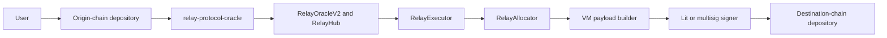

# Relay Settlement Protocol

The Relay Settlement Protocol is a multi-chain system for accounting for
deposits, settling orders, and authorizing withdrawals across heterogeneous
blockchains. This monorepo contains the Hub-chain smart contracts,
source- and destination-chain depository contracts, shared TypeScript tooling,
Lit signing actions, indexer applications, and price-feed ingesters.

Off-chain deposit observation, attestations, and environment configuration are
handled by
[`relay-protocol-oracle`](https://github.com/relayprotocol/relay-protocol-oracle).

## How it works



1. A user deposits into a depository on an origin chain. The deposit is bound
   to an order or another protocol action.
2. The oracle network observes the deposit and authorizes an action for
   `RelayInbox`, which updates the corresponding ERC-6909 balance in
   `RelayHub`.
3. `RelayExecutor` settles an order from its Hub balance. It can run solver
   conversion logic through an isolated call resolver and optionally draw
   bounded fixed draws or exact-output liquidity from funding pools.
4. `RelayAllocator` burns the Hub representation and delegates to the payload
   builder registered for the destination chain and depository.
5. The payload builder validates and encodes the withdrawal and produces the
   hashes that must be signed. Lit Actions or a multisig signer create the
   destination-chain signatures.
6. The signed payload executes against the destination depository, releasing
   funds to the withdrawal recipient.

See the [smart-contract documentation](./contracts/relay-chain/README.md) for the
complete architecture, contract responsibilities, and interaction flows.

## Repository structure

| Directory                              | Purpose                                                                                                              |
| -------------------------------------- | -------------------------------------------------------------------------------------------------------------------- |
| [`contracts`](./contracts) | Relay-chain settlement contracts, EVM/SVM depository projects and the xERC20 project   |
| [`packages`](./packages)               | TypeScript libraries, applications, Lit Actions, signing tools, and shared configuration |
| [`crates`](./crates)                   | Rust services that ingest signed Chainlink, Pyth, RedStone, and Stork price updates for the oracle infrastructure    |
| [`docs`](./docs)                       | Protocol documentation and published security audit reports                                                          |

The [contract index](./contracts/README.md), [package index](./packages/README.md),
and [crate index](./crates/README.md) describe each project.

### Main components

| Component                                                                                               | Purpose                                                                                                                     |
| ------------------------------------------------------------------------------------------------------- | --------------------------------------------------------------------------------------------------------------------------- |
| [`RelayHub` and settlement contracts](./contracts/relay-chain/README.md)                                      | Maintain cross-chain balances, apply oracle-authorized actions, execute orders, and allocate withdrawals                    |
| [`depository-evm`](./contracts/depository-evm) and [`depository-svm`](./contracts/depository-svm)                                                                   | Implements the Ethereum and Solana contracts that receive deposits and execute allocator-authorized withdrawals             |
| [`settlement-sdk`](./packages/sdk) and [`settlement-abis`](./packages/abis)                             | Provide shared protocol types, cross-VM codecs, and contract ABIs                                                           |
| [`settlement-networks`](./packages/networks)                                                            | Publishes supported-chain metadata and environment-specific contract addresses                                              |
| [`lit-allocator`](./packages/lit-allocator) and [`lit-deposit-address`](./packages/lit-deposit-address) | Derive protocol wallets, enforce transaction policies, and sign withdrawal or deposit-wallet transactions                   |
| [`multisig-tools`](./packages/multisig-tools)                                                           | Build, simulate, approve, submit, verify, and execute cross-VM multisig transactions                                        |
| [`indexer`](./packages/indexer) and [`indexer-ui`](./packages/indexer-ui)                               | Index settlement transfers, audit balances and coverage, expose an API, and provide an operational UI                       |
| [`crates`](./crates)                                                                                    | Supply provider-signed price payloads whose final verification is performed by the corresponding on-chain price adapter     |
| [`relay-protocol-oracle`](https://github.com/relayprotocol/relay-protocol-oracle)                       | Observes protocol events, produces attestations, and owns the environment configuration consumed by deployment verification |

## Development

The TypeScript and Solidity projects use Yarn 4 workspaces. Working across
those workspaces requires Node.js, Yarn, and Foundry with Soldeer:

```sh
yarn install
(cd contracts/relay-chain && forge soldeer install)
(cd contracts/depository-evm && forge soldeer install)
(cd contracts/xerc20 && forge soldeer install)
```

Run the main workspace checks from the repository root:

```sh
yarn build
yarn test
yarn lint
```

Pull-request and main-branch CI use `yarn build:typescript`, `yarn lint:ci`, and
`yarn test:typescript`. Each command runs at most two workspaces at once;
builds respect workspace dependency order, and each Vitest process uses one
worker to avoid nested concurrency exhausting the runner. Run
`build:typescript` before the other CI commands so their package outputs are
available. The indexer's CI commands reuse these outputs instead of cleaning
and rebuilding shared dependencies.

CI exports ABIs from its fresh builds of the Hub-chain and xERC20 projects
with `yarn workspace @relay-settlement/smart-contracts export:abis`. For local ABI
regeneration, continue to use `build:abis`, which cleans stale artifacts first.
Solidity build/ABI checks and tests, production Solidity coverage, and the
TypeScript build run independently. The TypeScript build uploads its outputs
once; lint and tests download them and run on separate runners to avoid CPU
contention. The required `Lint, build & test` check passes only when every
build, lint, test, and coverage job succeeds.

TypeScript tests use two runners: `test:typescript:deposit-address` runs the
Lit deposit-address suite, and `test:typescript:workspaces` runs the other
TypeScript suites and indexer tests. Both runners are required by the final
check. `yarn test:typescript` still runs both groups locally.

ESLint and Prettier cache per-file results by content under each workspace's
`node_modules/.cache/lint` directory. CI reuses successful caches across commits
only when Node.js, dependency manifests, the lockfile, shared lint code, and
lint/format configuration match. Changed files are checked again even when
their timestamps are unchanged. TypeScript type checks and Solhint still run
on every invocation. Delete the relevant workspace's `node_modules/.cache/lint`
directory to force a full lint after changing local plugin dependencies.

CI jobs cache installed dependencies and Yarn's install state using
an exact key derived from the runner platform, Node.js version, dependency
manifests, lockfile, Yarn configuration, and installation scripts. They still
run `yarn install --immutable` after restoration. Compiled workspace outputs
and Solidity artifacts are rebuilt rather than restored from this cache.
TypeScript outputs are shared only between jobs within the same workflow run.

These commands cover the root Yarn workspaces. The depository and xERC20
projects use independent Foundry and Anchor setups and must be checked separately:

```sh
cd contracts/depository-evm
forge build
forge test

cd ../depository-svm
anchor build
anchor test

cd ../xerc20
forge build
forge test
```

The Solidity workspace also exposes targeted Foundry-backed commands:

```sh
cd contracts/relay-chain
yarn build
yarn test
yarn coverage
```

`yarn coverage` reports production Solidity coverage only and fails when the
committed line, function, or branch threshold is not met.

The Rust price ingesters form a separate Cargo workspace:

```sh
cd crates
cargo build --workspace
cargo test --workspace
```

Deployment manifests and role or configuration wiring should be checked with
[`verify-deployment.ts`](./contracts/relay-chain/deployments/scripts/misc/verify-deployment.ts)
as described in the [smart-contract README](./contracts/relay-chain/README.md#deployments-and-verification).
