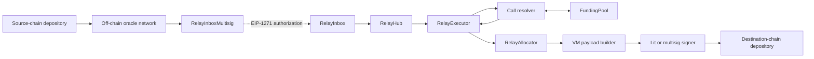

# Relay Settlement Smart Contracts

Solidity contracts for the Relay Settlement Protocol's hub-chain accounting,
oracle-authorized settlement, cross-chain withdrawals, deposit addresses,
pricing, and execution infrastructure.

The contracts use Solidity 0.8.28 and are built and tested with Foundry. They
are one part of a multi-chain system: source- and destination-chain depository
implementations live under [`depository-evm`](../depository-evm) and [`depository-svm`](../depository-svm),
off-chain observation and attestation are handled by
[`relay-protocol-oracle`](https://github.com/relayprotocol/relay-protocol-oracle),
and encoders and shared types live in the [`settlement-sdk`](../../packages/sdk).

## Architecture

The Hub chain is the protocol's accounting and coordination layer. Deposits on
supported chains are represented as balances in `RelayHub`; settlement consumes
those balances, optionally runs conversion or funding-pool draw logic, and turns the
result into a destination-specific withdrawal payload.



### Deposit and Hub accounting

1. A user deposits into a depository on an origin chain.
2. The off-chain oracle network observes the deposit and produces an
   authorization accepted through `RelayInboxMultisig`.
3. `RelayInbox` verifies the authorization and idempotency key, then applies
   its encoded `MINT`, `BURN`, `TRANSFER`, or `FAST_MINT` actions to `RelayHub`.
4. `RelayHub` records the cross-chain asset as an ERC-6909 token whose ID is
   derived from the origin chain slug and encoded currency. `ERC20View` exposes
   any Hub token through an ERC-20-compatible interface when integrations need
   one.

`FAST_MINT` makes funds available before slow finality. When configured by the
oracle authorization, it consumes budget through an allowlisted `IRateLimiter`
and may calculate a fee through an allowlisted `IFeeCalculator`.
`RelayInboxIdempotencyStore` preserves replay protection across oracle
versions.

### Order execution and withdrawal

1. Funds for an order sit at an exclusive, non-reused virtual address in
   `RelayHub`.
2. Anyone may relay an oracle-signed request to `RelayExecutor`. The executor
   pulls the address's complete live order balance, charges signed fees at most
   once, and transfers the net input to an `ICallResolver`. Fees and resolver
   funding use only this order's input; balances already on the executor are
   excluded.
3. The submitter chooses the resolver and calldata, which are intentionally
   outside the oracle signature so a solver can refresh its execution plan after
   authorization. The resolver runs without inheriting the executor's Hub
   privileges and must return at least the signed minimum output or the complete
   transaction reverts. The receiver is not guaranteed any additional execution
   value that the resolver does not return.
4. `RelayExecutor` measures this execution's output, checks the signed minimum,
   and funds that full principal in its allocator spender alias. A separate
   oracle-authorized payer funds any builder-reported withdrawal fee.
   Pre-existing output cannot satisfy the signed minimum or increase the
   withdrawal. Any input left from this execution is then returned to the order
   address, excluding pre-existing balances. When input and output are the same
   token, the output is settled before checking for remaining input. Returning
   input credits the order's Hub balance; it does not initiate an origin-chain
   refund.
5. `RelayAllocator` burns the Hub representation, selects the payload builder
   registered for the destination chain and depository, and records the encoded
   payload plus the hashes that must be signed.
6. An off-chain signer signs those hashes. A submitter combines the payload and
   signatures and executes the withdrawal through the destination depository.

Call resolvers are intentionally separate from `RelayExecutor`. The generic
`BasicCallResolver` supports isolated arbitrary calls, while `PoolDrawResolver`
adds bounded fixed draws and exact-output funding from `FundingPool`
accounts. Solver calls made during pool settlement run in `ResolverSandbox`,
which holds no pool roles. Pool-backed resolvers additionally commit their
resolver address and execution payload through the signed request nonce because
they can debit shared pool accounts; the generic resolver path does not
authorize that access.

`PoolDrawResolver.Execution` commits to `surplusPool` and `surplusAccount`
alongside its draw legs, calls, and salt. Plans with draw legs must supply both
addresses. After the draw legs settle, unused request input and output above
the signed output minimum are credited to that account using the pool's
`credit` function. For minimum 100 and output 120, the resolver reserves 100
and credits 20. A withdrawal fee is charged separately to the authorized payer;
it does not increase the reserve or reduce the surplus. The resolver must hold
`RESOLVER_ROLE` on the surplus pool. Draw-leg
credits still go to the account that funded that leg; the explicit request
surplus recipient avoids ambiguity when an order uses multiple accounts or
pools. Draw-leg credits name the order and leg, so the pool lowers that
order's net draw against the per-order cap and gives the leg's own draw back to
the finite budget that funded it, while that config is still in force; request
surplus credits name no order and only add to the balance.
When input and output are the same token, only the output surplus is
credited. Pool balances, credits, and withdrawals all revert if the signed
minimum is not met.

A plan without draw legs may set both surplus addresses to zero to retain
basic resolution, returning all request tokens to the executor. Supplying a
surplus recipient instead settles that plan to the signed minimum as well.

The surplus fields change the encoded pool execution payload. Use the matching
SDK encoder and resolver deployment together; older payloads must be rebuilt
and their commitment nonces and oracle authorizations regenerated. The
`RelayExecutor` entrypoint and signed request schema are unchanged. This change
prevents subsequent executions from consuming older executor balances; it does
not recover balances already stranded on a deployed executor.

`RelayExecutor` does not enforce order-address uniqueness itself. The protocol
must preserve the exclusive, non-reused address invariant because the executor
pulls the address's entire live input balance.

The contract does not authenticate a designated solver. Keeping the order and
oracle signature private, or restricting signature release, can reduce competing
fills operationally; it is not an on-chain authorization boundary once the
signed request becomes public.

### Payload configuration and withdrawal fees

`RelayAllocator` maps each `(chainId, depository)` pair to an `IPayloadBuilder`.
`buildPayload` remains `view` and returns `(bytes payload, WithdrawFee withdrawFee)`.
`WithdrawFee { bytes currency; uint256 amount; }` reports an additional fee
in a currency on `request.chainId`. Builders validate destination-specific policy
and construct the payload without looking up or collecting a gas payment.
Builders without an additional Hub debit return a zero fee.

Builders validate VM-specific addresses, currencies, transaction fields, and
policy before returning an unsigned payload and its signing digests.
The allocator counts the withdrawals it accepts per chain and block second
(`withdrawalsThisSecond`). Hyperliquid, which has no memo field, uses that count
as the millisecond of its nonce, so its nonces never repeat; a 1001st Hyperliquid
withdrawal in one second reverts and can be retried in the next. TON numbers its
Highload V3 query ids from the block second and that count, reusing one only
after four wallet timeouts, so two TON withdrawals of one allocator never share
one; a withdrawal past the second's share of the id space (581 at a one-hour
timeout) reverts. The TON builder is bound to one allocator and one chain id.

A Highload V3 wallet must have only one active issuance counter. Replay
entries can remain marked beyond two timeouts: rotation happens during message
processing and the cleanup comparisons are strict. A replacement allocator
restarts its counter, and the earlier hash-derived builder can issue ids that
overlap the deterministic schedule.

Before replacing an allocator or retiring a hash-derived builder, pause the
actual registered TON chain id (for example `ton`) on the old allocator
on-chain. Stop all old issuance and signing for the wallet, including other
wallet signers; stopping frontend routing alone leaves public submissions
available. Inventory pending payloads and their `created_at` values. Let `T`
be the unchanged wallet timeout, `C` the greatest old payload `created_at`, and
`L` the wallet's stored `last_clean_time` immediately before activation. Activate
only at actual TON time `N` with `N >= C + T` (old payloads have expired) and
`N > L + 2T` (the next message clears both replay maps). Account for clock
skew when comparing Hub build time with TON time, and verify the first new
message's cleanup and acceptance by simulation.

Without using the wallet's state to shorten the wait, `4T` after `C` is a
conservative bound once all old issuance/signing has stopped. Waiting alone
does not prevent newly issued old-format messages from colliding. Replacing a
deterministic builder while preserving the same allocator, chain, wallet,
timeout and numbering scheme keeps its counter continuous. Switching from the
legacy hash scheme still requires the cutover procedure, even when retaining
the allocator.

A spender that does not submit directly or through a Hub operator authorizes a
withdrawal with `submitWithdrawRequestWithSignature(withdrawRequestAuthorization)`.
The reusable `Authorization { uint256 expiration; bytes signature; }` argument
groups the signature with its expiry. `WithdrawRequestAuthorization` groups
`WithdrawRequest withdrawRequest` and `Authorization authorization`, matching the
fee-payment-authorization wrapper.
The spender (or, for non-EVM spenders, the oracle multisig) signs nested EIP-712
`WithdrawRequestAuthorization(WithdrawRequest request,uint256 expiration)` under domain
`RelayAllocator`, version `1`. `expiration` is the last valid Unix second; later
submissions revert with `SignatureExpired`. The SDK builds that digest with
`getWithdrawRequestAuthorizationHash` (`packages/sdk`, messages v2.4), and
`test/RelayAllocator/sdkFixture.t.sol` pins it against the contract.
`RelayGenericMapping` oracle signatures for `SetEntry` and `DeleteEntry` carry
the same `expiration` field.

A redeployed `RelayGenericMapping` takes the previous deployment as its immutable
`LEGACY` (deploy script env `LEGACY`), so existing entries are not migrated.
`getEntry` returns a legacy entry, with its original `createdAt`, until this
contract sets or deletes the same `(user, id)`. `setEntry` treats a live legacy
entry as existing, and `deleteEntry` deletes one by recording it in
`legacyEntryDeleted`, so it never reads through again. Revoke `ORACLE_ROLE` on
the previous deployment at cutover so its entries can no longer change.

The allocator authenticates the spender, builds the payload, verifies an oracle
fee authorization, and burns principal from the spender's Hub alias and the fee
from the separately designated payer's Hub alias. It emits
`WithdrawFeePaid(requestHash, feePayerAlias, tokenId, amount)` for a nonzero fee.
Fee collection, principal burning, both authorization records, payload/hash
storage, and the per-second withdrawal counter all roll back if any step fails.
There is no fallback to charging the withdrawal output if the payer lacks funds.

The fee authorization contains:

```solidity
struct Authorization {
  uint256 expiration;
  bytes signature;
}
struct WithdrawRequestAuthorization {
  WithdrawRequest withdrawRequest;
  Authorization authorization;
}
struct WithdrawFeePayment {
  string payerChainId;
  bytes payer;
  bytes currency;
  uint256 maxAmount;
}
struct WithdrawFeePaymentAuthorization {
  WithdrawFeePayment withdrawFeePayment;
  Authorization authorization;
}
```

The allocator's `ORACLE_MULTISIG`
authorizes the debit; the fee payer need not be the withdrawal spender. EOAs and
ERC-1271 oracle contracts are supported. The fee currency belongs to the
withdrawal chain and may differ from the principal currency. The allocator
charges the builder-reported amount, not the entire signed ceiling.

`hashWithdrawFeePaymentAuthorization(request, withdrawFeePayment, expiration)` returns the EIP-712 digest
under the `RelayAllocator` version `1` domain. For this digest only,
`request.amount` is set to zero, allowing the output amount to be determined at
execution. Every other request field is bound: chain, depository, currency,
spender chain/identity, receiver, data, and nonce. The payment also binds payer
chain/identity, fee currency, ceiling, and expiration. Each digest is consumed
once, so changing the runtime amount cannot replay a payment. The oracle must
use a unique request nonce per intended withdrawal. Expiration is inclusive.
Canonical withdrawal hashes, spender signatures and destination identifiers
retain the actual full withdrawal amount.

Direct callers use `submitWithdrawRequest(request, withdrawFeePaymentAuthorization)`. Relayed
callers use `submitWithdrawRequestWithSignature(withdrawRequestAuthorization, withdrawFeePaymentAuthorization)`. The spender signature independently uses
`WithdrawRequestAuthorization(WithdrawRequest request,uint256 expiration)` and binds
the exact principal. Use `hashWithdrawRequestAuthorization` or the SDK's
`getWithdrawRequestAuthorizationHash`. Fee authorization never grants permission to
withdraw another spender's principal. Both signed submission overloads share
spender nonce consumption, and historical non-expiring spender signatures are
not accepted by the new allocator. Existing submission overloads without fee
authorization accept only builders reporting zero additional fee.

Gateway reports the burn intent's `maxFee`: the configured fixed source fee plus
the rounded-up source transfer fee when crossing Circle domains. TON reports its
configured native TON fee; XRP reports the validated transaction fee in drops.
The charged amount covers the maximum destination fee; it is not a later
measurement or reimbursement of the fee actually spent on the destination.

For swaps, call the new executor overload
`execute(request, callResolver, callResolverData, oracle, signature, withdrawFeePaymentAuthorization)`.
It passes the separate authorization through to the allocator and withdraws the
full measured output. For output 100 and fee 2, the withdrawal is 100 and the
payer loses 2. The execution request tuple and signed digest are unchanged;
`outAmountMinimum` continues to apply to the full withdrawal principal. The
original executor overload remains available for zero-fee withdrawals. Builders
and allocators do not need net-amount or gross-budget quote methods for this flow.

Both executor overloads set the allocator withdrawal's `nonce` to
`hashExecuteAndWithdrawRequest(request)`, the full EIP-712 digest including the
executor address and chain ID. Build the fee authorization using this derived
nonce, not the execution request's original `nonce`. This binds the fee payment
to the exact signed execution, including its order address, input, minimum
output, fees, and deadline. A reverted execution leaves both authorizations
available for another relayer to retry that same order, with a runtime output
that still satisfies the signed minimum. Another signed order cannot reuse the
fee authorization. The original execution nonce is still passed unchanged to
the resolver, preserving pool plan commitments. Allocator withdrawal hashes and
downstream identifiers change because they include the derived nonce.

SDK executor signing remains under `messages/v2.3/withdrawal` and the existing
root exports. `messages/v2.4/withdrawal` adds `WithdrawFeePayment`,
`WithdrawFeePaymentAuthorization`, and `getWithdrawFeePaymentAuthorizationHash`. The shared
`Authorization` type is in `messages/v2.4/authorization`. Spender
authorization helpers remain in `messages/v2.4/withdraw-request-authorization`. Both are
exported from the SDK root.

#### Migration from prepaid fees

Deploy the allocator, executor and all builders together with their updated
ABIs. The `buildPayload` return encoding changes even though its selector does
not. Gateway, TON and XRP constructors no longer take a gas-payer address.
Signed allocator submissions now take the `WithdrawRequestAuthorization` tuple.
Regenerate spender and fee signatures for the `WithdrawRequestAuthorization`
and `WithdrawFeePaymentAuthorization` EIP-712 names. Their constants are
`WITHDRAW_REQUEST_AUTHORIZATION_TYPEHASH` and
`WITHDRAW_FEE_PAYMENT_AUTHORIZATION_TYPEHASH`; both commit to expiration.
Update the oracle to sign separate fee authorizations, use the matching SDK
allocator helpers, and configure builder registrations before routing withdrawals
to the new allocator. Existing executor request signatures keep their schema. Event
consumers should track `WithdrawFeePaid` on the allocator instead of relying
on legacy `GasPaid` events from a separate payer.

`WithdrawGasPayer`, `GasPaidPayloadBuilder`, and their deployment script and
standalone tests have been removed. The separately funded payer debit happens
during withdrawal. Previously burned prepayments are not migrated or refunded.
Historical address records and indexer decoding remain available for past deployments.

Deployment verification uses allocator-collected fees. Retained historical payer
addresses do not require payer roles or removed `GAS_PAYER()` getters.
The multisig package, including its legacy Gateway generators, is unchanged;
updates to those generators are outside this PR.

### Emergency controls

`RelayAllocator` gives its owner controls that stop new withdrawals at the
point where Hub balances are burned:

- `pause()` halts every new submission. `submitWithdrawRequest` and
  `submitWithdrawRequestWithSignature` revert with `EnforcedPause` while paused,
  before any authorization, payload build, or burn. `unpause()` resumes them.
  Both emit the OpenZeppelin `Paused(account)` and `Unpaused(account)` events.
- `pauseChains(chainIds)` halts new submissions bound for the listed destination
  chains only; submissions to them revert with `DestinationChainPaused` and
  every other chain keeps working. `unpauseChains(chainIds)` resumes them. Each
  chain emits `ChainPaused(chainId, hasPayloadBuilder)` or `ChainUnpaused(chainId)`;
  `hasPayloadBuilder` is false when no depository on that chain id has a
  builder, which flags a pause under a mistyped chain id. The list lets
  one transaction cover a whole VM family when its signer is in question.
- `suspend(alias)` blocks principal withdrawals and nonzero fee debits from that
  Hub alias, derived from the spender or fee payer's chain id and address bytes.
  Either check reverts the entire submission with `SpenderSuspended(alias)`;
  balances and authorizations remain unchanged. `unsuspend(alias)` lifts the
  block, allowing an unexpired authorization to be retried. Suspensions can be
  managed while the allocator is paused and stay in force after it resumes.

None of these controls invalidates payloads or signing hashes that were
already recorded. An off-chain signer that wants a pause or suspension to
cover in-flight requests must read `paused()`, `pausedChains(chainId)`, and
`suspended(alias)` before signing. Owner administration (`setPayloadBuilder`,
`suspend`, `unsuspend`, `pauseChains`, `unpauseChains`) is not paused.

Fee collection happens inside allocator submission, so every emergency control
also stops the associated fee debit.

### Deposit-address flow

`RelayDepositAddressManager` records an order trigger together with deterministic
derivation fields and prices returned by a selected `IPricingOracle`. The
off-chain oracle attests that trigger, and the Lit deposit-address actions verify
the attestation before deriving or signing with the matching deposit wallet.
See [`lit-deposit-address`](../../packages/lit-deposit-address) for the derivation
and transaction-policy implementation.

`SignedPricingOracle` rejects zero USD prices in solver-signed fallback data,
so a zero input price cannot bypass the deposit-address price-impact check.
It resolves each currency independently, preserving healthy on-chain prices when
another currency needs fallback. Per-currency oracle reverts with nonempty data
allow solver-signed fallback for that currency; failures without revert data
(including out-of-gas failures) revert the entire resolution. This oracle imposes
no batch-size limit because it queries the on-chain oracle one currency at a time.

### Pricing

`RelayPriceOracle` maps Hub currencies to provider feeds. It obtains the latest
signed update from `PriceOraclePrecompile`, delegates provider-specific
verification and decoding to an `IPriceFeedAdapter`, and enforces freshness and
monotonic publish times. The resulting prices are consumed by USD rate limits,
fast-mint fee calculation, and any deposit-address trigger configured to use
this oracle.

## Contract directory

### Core contracts

| Contract                                                                       | Purpose                                                                                                                                                |
| ------------------------------------------------------------------------------ | ------------------------------------------------------------------------------------------------------------------------------------------------------ |
| [`RelayHub.sol`](./contracts/RelayHub.sol)                                     | ERC-6909 accounting ledger for assets deposited across chains; authorized operators mint, burn, and move balances                                      |
| [`ERC20View.sol`](./contracts/ERC20View.sol)                                   | ERC-20-compatible facade for one Hub token ID, forwarding balances, transfers, allowances, and metadata to `RelayHub`                                  |
| [`RelayInbox.sol`](./contracts/RelayInbox.sol)                                 | Verifies oracle-authorized action batches, enforces shared idempotency, and executes standard or rate-limited fast settlement against the Hub          |
| [`RelayInboxMultisig.sol`](./contracts/RelayInboxMultisig.sol)                 | Owner-managed threshold signer implementing EIP-1271 for oracle authorizations used by the oracle, executor, allocator, and related contracts          |
| [`RelayInboxIdempotencyStore.sol`](./contracts/RelayInboxIdempotencyStore.sol) | Shared replay-protection store that can also honor keys consumed by legacy oracle contracts                                                            |
| [`RelayExecutor.sol`](./contracts/RelayExecutor.sol)                           | Executes an oracle-signed order, charges fees, isolates solver calls in a resolver, checks minimum output, and initiates the allocator withdrawal      |
| [`RelayAllocator.sol`](./contracts/RelayAllocator.sol)                         | Burns Hub balances for withdrawals, selects the destination payload builder, and records payloads and signing hashes                                   |
| [`Config.sol`](./contracts/Config.sol)                                         | Generic `bytes32` configuration store administered by the current owner of its configured allocator                                                    |
| [`RelayPriceOracle.sol`](./contracts/RelayPriceOracle.sol)                     | Routes currencies to provider feeds, verifies updates through adapters, and exposes normalized USD and bid/ask prices                                  |
| [`RelayGenericMapping.sol`](./contracts/RelayGenericMapping.sol)               | Replay-protected per-user data store whose set and delete operations require an authorized oracle signature                                            |
| [`RelayMultisigSigner.sol`](./contracts/RelayMultisigSigner.sol)               | Safe-owned Aurora contract that approves messages and requests ECDSA or EdDSA signatures from NEAR Chain Signatures                                    |
| [`ChainSignatures.sol`](./contracts/ChainSignatures.sol)                       | Encodes JSON requests and byte strings for the NEAR Chain Signatures service                                                                           |
| [`Utils.sol`](./contracts/Utils.sol)                                           | Shared token-ID, virtual-address, EIP-712, and endian-encoding helpers                                                                                 |
| [`Multicall3.sol`](./contracts/Multicall3.sol)                                 | Multicall-compatible batch executor that preserves the original revert data from required calls                                                        |
| [`RelayHubBalanceViewer.sol`](./contracts/RelayHubBalanceViewer.sol)           | Read-only lens that resolves an origin-chain account and currency, given as plain address strings, to its Hub alias, token id, ERC20View, and balances |
| [`HubAddressCodec.sol`](./contracts/HubAddressCodec.sol)                       | Decodes `0x` hex, base58 (Solana), base58check (Tron, legacy Bitcoin) and bech32 (Bitcoin segwit) address strings into the byte form the Hub hashes    |

### `call-resolvers/`

Call resolvers receive only the current order's input from `RelayExecutor` and
return its output without receiving the executor's Hub operator privileges.

| Contract                                                                    | Purpose                                                                                                         |
| --------------------------------------------------------------------------- | --------------------------------------------------------------------------------------------------------------- |
| [`ICallResolver.sol`](./contracts/call-resolvers/ICallResolver.sol)         | Defines the oracle-signed execute-and-withdraw request and the resolver interface                               |
| [`BasicCallResolver.sol`](./contracts/call-resolvers/BasicCallResolver.sol) | Reference resolver that executes arbitrary calls and sweeps selected Hub token balances to specified recipients |
| [`PoolDrawResolver.sol`](./contracts/call-resolvers/PoolDrawResolver.sol)   | Settles ordered fixed or shortfall draw legs against funding-pool accounts around the solver's request calls    |
| [`PoolResolverBase.sol`](./contracts/call-resolvers/PoolResolverBase.sol)   | Shared trusted mechanics for payload commitments, pool debits and credits, token conversion, and final sweeps   |
| [`ResolverSandbox.sol`](./contracts/call-resolvers/ResolverSandbox.sol)     | Unprivileged, resolver-owned executor for solver calls; it cannot invoke role-gated pool debits                 |

### `deposit-addresses/`

| Contract                                                                                         | Purpose                                                                                                                        |
| ------------------------------------------------------------------------------------------------ | ------------------------------------------------------------------------------------------------------------------------------ |
| [`RelayDepositAddressManager.sol`](./contracts/deposit-addresses/RelayDepositAddressManager.sol) | Records uniquely identified deposit-address triggers binding order inputs, derivation fields, prices, and oracle-specific data |
| [`oracle/IPricingOracle.sol`](./contracts/deposit-addresses/oracle/IPricingOracle.sol)           | Defines cross-chain currency, mid-price, and bid/ask types plus pricing-oracle interfaces                                      |
| [`oracle/BasicPricingOracle.sol`](./contracts/deposit-addresses/oracle/BasicPricingOracle.sol)   | Minimal implementation that decodes caller-supplied prices directly from `extraData`                                           |
| [`oracle/SignedPricingOracle.sol`](./contracts/deposit-addresses/oracle/SignedPricingOracle.sol) | Prefers `RelayPriceOracle` prices and falls back to expiring EIP-712 prices from the solver fixed at deployment                |

### `fee-calculators/`

| Contract                                                                             | Purpose                                                                                                |
| ------------------------------------------------------------------------------------ | ------------------------------------------------------------------------------------------------------ |
| [`IFeeCalculator.sol`](./contracts/fee-calculators/IFeeCalculator.sol)               | Pluggable interface for calculating a `FAST_MINT` fee, its currency, payer, and recipient              |
| [`RelayBpsFeeCalculator.sol`](./contracts/fee-calculators/RelayBpsFeeCalculator.sol) | Converts a configured fraction of deposit USD value into a capped amount of the requested fee currency |

### `funding-pools/`

Funding pools custody ordinary ERC-20s or Hub assets through their `ERC20View`
contracts. Balances are attributed per account; each account independently
sets resolver allowlists, per-order caps, budgets, expirations, and an
authorizer for individual orders.

Each draw authorization signs the account, the order, the hash of the committed
execution plan, the account's current draw nonce and a deadline, so it
cannot be spent on a plan the authorizer never saw and dies with any change to
the account's guardrails. See [draw authorizations](./docs/draw-authorization.md)
for the EIP-712 shape, the per-leg envelope and the relayer flow.

| Contract                                                                     | Purpose                                                                                                                |
| ---------------------------------------------------------------------------- | ---------------------------------------------------------------------------------------------------------------------- |
| [`IFundingPool.sol`](./contracts/funding-pools/IFundingPool.sol)             | Defines pool balances, draw modes, standing draw configuration, signed updates, withdrawals, and order authorizations  |
| [`FundingPool.sol`](./contracts/funding-pools/FundingPool.sol)               | Holds per-account token balances and permits bounded, replay-safe resolver draws plus signed or role-gated withdrawals |
| [`FundingPoolFactory.sol`](./contracts/funding-pools/FundingPoolFactory.sol) | Deterministically deploys full funding-pool contracts with `CREATE2` and tracks pools it created                       |

#### Funding pool deployment and signing migration

Deploy the updated factory as well as new pool instances: the factory embeds
`FundingPool` creation code, so an old factory continues deploying old
logic. The factory address and changed creation code change CREATE2 predictions
even when the salt and roles are reused. Predict through the new factory and
update account setup, resolver allowlists, deployment records and funding
destinations before depositing funds. Existing pool balances, account configs,
nonces and authorizations are not copied by deploying a replacement.

Update every resolver caller of `credit` to pass the order address and leg
index for draw repayment and zeros for unrelated surplus. Use the matching
`v2.4/funding-pool` SDK for the nonce-bearing `DrawRevocation` signature and
the new `revokeDrawAuthorizations(uint256)` call, and always derive that nonce
with `getRandomFundingPoolRevocationNonce(drawNonces(account))`: a predictable
nonce such as `+1` kills nothing the authorizer pre-signed. The pool checks the
jump bounds against the nonce current when the revocation executes, so a signed
revocation whose remaining gap queued updates have pushed under
`MIN_DRAW_NONCE_JUMP` must be re-signed; the SDK's floor of twice the minimum
makes that practically unreachable. Rebuild pool-bound
authorizations for the new verifying-contract address; old signatures cannot
migrate pool state.
Keep the old pool's withdrawal and settlement access available until its
balances and pending work have been reconciled, then retire its resolver roles.

The protocol indexer pins the `FundingPool` ABI per deployment, so bump it
with the new pool: re-pin `FundingPool` in `crates/contracts-evm/abis.toml` to
the deployed commit, then update `PoolCredited` for the new `Credited` shape
(`orderAddress` and `legIndex` identify the refunded leg; `requestHash` is now
data, not a topic; `restored` and `budgetRestored` are new) in
`crates/protocol-indexer/src/chains/relay/events.rs` (decoding, the topic
list and the fixture) and `crates/protocol-indexer/src/api/http.rs` (the API
type), and confirm `crates/protocol-indexer/src/chains/relay/bindings.rs`
still lists `FundingPool::Credited`. Until the pin moves, the indexer's log
filter uses the old `Credited` topic and will not fetch the new pool's
credits.

### `payload-builders/`

All primary builders implement `IPayloadBuilder`, returning an encoded payload,
the hashes to sign, a signing curve, and a VM family name.

| Contract                                                                                          | Purpose                                                                                                                        |
| ------------------------------------------------------------------------------------------------- | ------------------------------------------------------------------------------------------------------------------------------ |
| [`BitcoinVmPayloadBuilder.sol`](./contracts/payload-builders/BitcoinVmPayloadBuilder.sol)         | Builds P2WPKH Bitcoin withdrawals, including allocator and fee UTXOs, change, an order identifier, and BIP-143 signing digests |
| [`EthereumVmPayloadBuilder.sol`](./contracts/payload-builders/EthereumVmPayloadBuilder.sol)       | Builds EIP-712 EVM depository call requests, including versioned routed withdrawals through allowlisted routers                |
| [`TronVmPayloadBuilder.sol`](./contracts/payload-builders/TronVmPayloadBuilder.sol)               | Builds Tron depository call requests using Tron address validation and EIP-712-compatible signing data                         |
| [`SolanaVmPayloadBuilder.sol`](./contracts/payload-builders/SolanaVmPayloadBuilder.sol)           | Builds Solana depository transfer instructions from configured domains, vaults, and expiration policy                          |
| [`TonVmPayloadBuilder.sol`](./contracts/payload-builders/TonVmPayloadBuilder.sol)                 | Builds native TON transfers for Highload Wallet V3 and reports the configured fee                                              |
| [`XrpVmPayloadBuilder.sol`](./contracts/payload-builders/XrpVmPayloadBuilder.sol)                 | Builds native-XRP payments for a fixed signing key and reports the transaction fee                                             |
| [`HederaVmPayloadBuilder.sol`](./contracts/payload-builders/HederaVmPayloadBuilder.sol)           | Builds direct Hedera `CryptoTransfer` transactions for HBAR or one configured HTS token, with submitter-paid fees              |
| [`HyperliquidVmPayloadBuilder.sol`](./contracts/payload-builders/HyperliquidVmPayloadBuilder.sol) | Builds Hyperliquid `usdSend` and `sendAsset` actions using configured symbols, decimals, and DEX routing                       |
| [`LighterVmPayloadBuilder.sol`](./contracts/payload-builders/LighterVmPayloadBuilder.sol)         | Builds Lighter transfer actions using configured account route types and asset indexes, with a bounded USDC transfer fee       |
| [`AtlasVmPayloadBuilder.sol`](./contracts/payload-builders/AtlasVmPayloadBuilder.sol)             | Builds and hashes the atlas/1 Transfer out of the configured depository; asset decimals come from Config                       |
| [`GatewayVmPayloadBuilder.sol`](./contracts/payload-builders/GatewayVmPayloadBuilder.sol)         | Builds Circle Gateway burn intents and delegates the destination execution payload to a VM-specific builder                    |

`AtlasVmPayloadBuilder` builds a native Atlas transfer from the depository's
Atlas account (the 20-byte `depository` it is registered under) to the receiver,
signed as EIP-712
`Transaction(address signer,NonceGapless nonce,Transfer action)` under
`{name: "atlas", version: "1", chainId, salt}`, with the depository as signer.
The depository wallet's owner nonce is gapless: Atlas books a transaction only
while its nonce is exactly one above the last one accepted and it has not
expired. The caller passes the next nonce as `request.data = abi.encode(uint64)`
(at least 2; the wallet-opening bind takes 1), and the builder sets the expiry
to the block time plus the configured delay. The payload holds the transfer
exactly as signed: the amount is scaled once to Atlas's fixed 12-decimal signing
scale, and the memo tail is the nonce. Config values, keyed by the Relay chain
id: the domain chain id under `getDomainChainIdKey(chainId)` (43003 on testnet),
the domain salt under `getDomainSaltKey(chainId)` (`keccak256("atlas/testnet")`
on testnet), the expiration delay in seconds under `getExpirationKey(chainId)`
(at most 14 days, the longest Atlas accepts), and per currency the decimals of
protocol amounts under `getAssetDecimalsKey(chainId, currency)` (at most 12). A
build missing any of them reverts with `ConfigValueNotSet`.

The allocator stores every payload, so the Lighter, Atlas and Hyperliquid
builders encode the action inline after its type rather than as nested
ABI-encoded `bytes`:

| Builder          | Payload                                                                                              |
| ---------------- | ---------------------------------------------------------------------------------------------------- |
| `lighter-vm`     | `abi.encode(uint8 actionType, LighterTransferRequest)` (12 static words)                             |
| `atlas-vm`       | `abi.encode(AtlasPayloadHeader, AtlasTransfer)`, the header ending in `actionType` (12 static words) |
| `hyperliquid-vm` | `abi.encode(uint8 txType, <UsdSendRequest or SendAssetRequest fields>...)` as one top-level tuple    |

`hashesToSign` decodes the type (for Atlas, the header) on its own first, so an
unsupported type reverts before the rest is decoded. Payloads stored by earlier
builder deployments keep the previous envelope layout (the action as an
ABI-encoded `bytes` field); their signing hashes are unchanged, and the SDK
withdrawal codecs decode both layouts. Atlas is the exception: its payloads built
before the Nov 9 Atlas release can no longer be booked, so the SDK decodes only
the gapless layout.

Bitcoin input limits are controlled by the allocator owner through `Config`.
Deploy `BitcoinVmPayloadBuilder` with `(configAddress, allocatorChangeScript)`;
the deployment script requires `CONFIG` and `ALLOCATOR_CHANGE_SCRIPT`.
Set `builder.getMaxInputsKey()` (`keccak256("BITCOIN_VM_MAX_INPUTS")`) to a
`bytes32`-encoded unsigned integer using `Config.setConfigValue`. For example,
`bytes32(uint256(16))` permits at most 16 combined allocator and fee inputs.
An unset key, zero, or any config lookup revert leaves the input count
unrestricted. The key is shared by Bitcoin builders using the same Config
contract and is read on every build.

Oversized requests revert with `TooManyInputs` before input processing and
payload construction, so allocator submissions neither store the payload nor
burn the Hub claim. Existing deployments need a replacement builder configured
on the allocator to enforce the limit. Previously stored payloads and their
signing hashes remain unchanged; the limit only applies to new submissions.

The Bitcoin payload is `abi.encode(BitcoinVmTransactionData)`, whose inputs are
`(bytes32 txid, uint32 index, bytes script, uint64 value)` and whose outputs are
`(uint64 value, bytes script)`. `txid` is in serialized outpoint byte order (the
reverse of the hex txid shown by explorers); `index` and `value` are plain
integers that are serialized little-endian in the transaction and its BIP143
digests. Builders deployed before this encoding stored the same fields as
already-serialized `bytes`, so payloads they stored keep that older layout.

A Hyperliquid `sendAsset` currency is revoked by zeroing its symbol key: a
symbol that decodes to an empty string reverts with `CurrencySymbolNotSet`.
Zero DEX and decimals values are valid (`""` is the perp DEX).

Lighter transfer fees are bounded per chain. `LighterVmPayloadBuilder` rejects a
`usdcFee` above `DEFAULT_MAX_USDC_FEE` (3 USDC) unless the allocator owner sets
`builder.getMaxUsdcFeeKey(chainId)`
(`keccak256(abi.encodePacked(keccak256("LIGHTER_VM_MAX_USDC_FEE"), chainId))`) to a
`bytes32`-encoded unsigned integer using `Config.setConfigValue`, in which case that
value is the ceiling; zero admits fee-free transfers only. An unset key or any config
lookup revert leaves the default in place. The key is read on every build, and since
`Config` values cannot be unset, restoring the default after an override means
setting the key to `bytes32(uint256(3_000_000))`. The Lighter sequencer
already rejects any fee that differs from its live quote, so the bound only limits
what one request can ask the shared depository account to pay should that check
change. Oversized requests revert with `FeeExceedsMaxFee` before payload
construction, so allocator submissions neither store the payload nor burn the Hub
claim. Existing deployments need a replacement builder configured on the allocator
to enforce the bound; previously stored payloads and their signing hashes remain
unchanged.

Each Lighter deployment is a separate Relay chain served by the one generic
`LighterVmPayloadBuilder`. The instance-specific values signed into every
transfer are Config values keyed by the Relay chain id: the depository account
index under `builder.getFromAccountIndexKey(chainId)`
(`keccak256(abi.encodePacked(keccak256("LIGHTER_VM_FROM_ACCOUNT_INDEX"), chainId))`)
and the Lighter app-chain id under `builder.getLighterChainIdKey(chainId)`
(`keccak256(abi.encodePacked(keccak256("LIGHTER_VM_CHAIN_ID"), chainId))`). Both
are required; a build for a chain missing either reverts with
`ConfigValueNotSet`. The `depository` the allocator routes a request under must
decode to the configured account index, or the build reverts with
`DepositoryMismatch`, so the signed source account is always the registered one. Lighter mainnet (`lighter`) signs with app-chain id 304 and
Robinhood Lighter (`robinhood-lighter`) with 466324 and USDG collateral. Adding
another Lighter instance means registering the shared builder on the allocator
for the new chain and depository and writing its Config values; no new builder
is deployed. The route-type and asset-index keys are also derived from the Relay
chain id, hashed so that no chain id and currency pair can alias another's
(`keccak256(abi.encodePacked(keccak256("LIGHTER_VM_ASSET_INDEX"), keccak256(bytes(chainId)), currency))`,
likewise for `LIGHTER_VM_FROM_ROUTE_TYPE` and `LIGHTER_VM_TO_ROUTE_TYPE`), and
the request currency must be the 16-byte lighter-vm encoding or the build
reverts with `InvalidCurrencyLength`. Lighter has no asset 0, so an asset index
of zero marks a currency disabled: since `Config` values cannot be unset,
withdrawals of a currency are stopped by writing zero to its asset-index key,
after which builds revert with `CurrencyDisabled`. Route type 0 is the valid
perpetuals route, so zeroing the route-type keys does not disable a currency.
When replacing a builder whose keys used the earlier
`abi.encodePacked(PREFIX, chainId, currency)` derivation, write every Lighter
chain's route-type and asset-index values under the new builder's keys before
calling `setPayloadBuilder` for it; otherwise every Lighter withdrawal reverts
with `ConfigValueNotSet`.
Each deployment carries its own currency set, listed with the app-chain ids in
[`lighter-vm-currency-sets.ts`](./deployments/scripts/payload-builders/lighter-vm-currency-sets.ts).
[`configure-lighter-vm-payload-builder.ts`](./deployments/scripts/payload-builders/configure-lighter-vm-payload-builder.ts)
writes a deployment's registration and Config values, and
[`verify-lighter-vm-payload-builder.ts`](./deployments/scripts/payload-builders/verify-lighter-vm-payload-builder.ts)
confirms its Config wiring, allocator registration, Config values, and a decoded
sample transfer against the expected account index and app-chain id. Values
carried over from a previous builder that differ from the currency set are
declared with `EXPECT_VALUES="ETH Spot=2,2,7;USDC Spot=1,1,3"`
(`<label>=<fromRouteType>,<toRouteType>,<assetIndex>`; unlisted enabled
currencies keep the set defaults, a listed currency whose chain values differ
fails, and asset index 0 is rejected there). Tell it
which currencies are meant to be disabled with
`EXPECT_DISABLED="ETH Spot,USDC Spot"` (currency-set labels, comma-separated):
a listed currency whose on-chain asset index is zero is reported as an
informational `[disabled] <label>` line, its default values and sample transfer
are not asserted, and the verifier asserts instead that `buildPayload` for it
reverts `CurrencyDisabled`. A zero for any currency not listed fails, as does a
listed currency that is actually enabled, so an all-disabled deployment never
passes by accident; the summary line prints `disabled: N/M`. Builders
deployed before this change take the account index and app-chain id as
constructor immutables (`FROM_ACCOUNT_INDEX`, `LIGHTER_CHAIN_ID`) and remain one
per deployment until they are replaced.

#### Migrating Lighter currency configuration

The hardened route-type and asset-index keys hash the Relay chain id. Existing
values under legacy keys are not read by the new builder. Before registration,
record every served `(chainId, currency)` and read its current values using the
old builder's key getters and its Config store. Read the replacement builder's
getters to obtain the new keys, then write the recorded values to those keys.
Preserve explicit zero asset indexes as disabled routes, preserve zero route
types as valid values, and keep missing entries disabled until intentionally
configured. Include both `lighter` and `robinhood-lighter` and any custom routes.

`configure-lighter-vm-payload-builder.ts` and the multisig generators (`generate-configure-bitcoin-hyperliquid-lighter.ts`,
`generate-configure-robinhood-lighter.ts`) share the planner in
[`lighter-vm-config-plan.ts`](./deployments/scripts/payload-builders/lighter-vm-config-plan.ts):
every key is read back before writing, and a key already set under the target
builder is authoritative: the planner never rewrites it to the currency-set
default, so re-running on a configured deployment sends nothing, and a value
that drifted from the set (for example one carried over from a previous
builder) is only reported with a `[keep] <label>: on-chain 2,2,7 differs from
set default 1,1,1` line. To change a set value on purpose, write the new value
to the key directly (`Config.setConfigValues` from the allocator owner) or
disable the currency by writing zero and re-enable it through
`REENABLE_CURRENCIES`, which writes the set default. An on-chain
asset index of zero is never overwritten with the currency set's default: the
run logs a `[disabled]` warning and leaves the zero in place while the route
types, the instance keys and the other currencies are still written. To
deliberately re-enable a currency, list its label from the currency set in
`REENABLE_CURRENCIES` (comma-separated, matched exactly, for example
`REENABLE_CURRENCIES="ETH Spot,USDC Spot"`); a label that matches no currency
is an error. Because the new keys are all unset under a replacement builder,
pass the builder being replaced as `PREVIOUS_PAYLOAD_BUILDER`: a currency whose
new keys are unset is then migrated, not seeded. Its route types and asset index
are read under the previous builder's keys and those exact values are written to
the new keys, even where they differ from the currency set (the run logs
`[migrate] <label>: carried 2,2,7 (set default 1,1,1)` for such a currency); an
unset legacy route type falls back to the currency-set default, and a zero or an
unset legacy asset index (a route that was never configured) is written as an
explicit `0` under the new key, so the disabled state lives in the new namespace
and every later run keeps it without any env. A new key that is already set is
left as it is. A currency whose
asset-index key is unset while its route-type keys are set is refused unless
`PREVIOUS_PAYLOAD_BUILDER` or its label in `REENABLE_CURRENCIES` is supplied;
the default is never written on that path. `PREVIOUS_PAYLOAD_BUILDER` must
differ from the target, and a previous builder under which no currency has a
non-zero asset index is refused as a likely wrong address, since the plan would
write `0` for every currency and stop every withdrawal; `CONFIRM_DISABLE_ALL=1`
confirms that on purpose. Without a previous builder, a builder whose currency
keys are all unset is refused unless `MIGRATION_REVIEWED=1` confirms a
first-time configuration. The two flags are deliberately distinct: confirming a
fresh deployment never authorises disabling every currency. Point the helper at
the replacement builder, execute and verify Config writes first, then register
it. Simulate one enabled withdrawal and one deliberately disabled route for each
served chain before cutover.

Gateway withdrawals support an optional source-chain block-height ceiling in
`Config`, keyed by `GatewayVmPayloadBuilder.getMaxBlockHeightKey(chainId)` for
the logical Gateway source (for example, `polygon-gateway`). When configured,
the builder accepts only `0 < maxBlockHeight <= configuredCeiling`. An unset key
preserves the existing behavior: any nonzero height is accepted. Explicit zero
blocks new payloads. Configuration for another source or destination does not
affect this ceiling. Only a missing value for this exact key permits fallback;
other configuration errors revert.

The ceiling is an absolute source-chain height, not a block offset or timestamp.
Relay Chain cannot read another chain's current height, so an enabled ceiling
needs periodic owner updates based on a trusted source-chain head and an approved
finite horizon. Account for Circle's withdrawal delay and the destination
execution allowance. The ceiling never advances automatically with Relay Chain
blocks or time; a stale ceiling can prevent new withdrawals. This bound does not
prove source-chain freshness or equate block-height expiry with the destination's
timestamp expiry. Live source-height validation and the destination depository's
execution deadline remain separate checks.

The Gateway configuration script accepts optional `MAX_BLOCK_HEIGHT`; omitting
it leaves existing configuration unchanged, and `0` explicitly disables new
payloads for that source. Use `DRY_RUN=1` to review transactions. Ceiling updates
use the existing owner-only `Config.setConfigValue` with the same key. Deploy and
register a replacement builder to activate this logic, and set a finite ceiling
for each source where the bound should apply. Already-built payloads and stored
signing hashes are unaffected; this policy applies to new payload construction.

The Gateway subdirectory contains the destination abstraction and Circle wire
format used by `GatewayVmPayloadBuilder`:

| Contract                                                                                                                                        | Purpose                                                                                                  |
| ----------------------------------------------------------------------------------------------------------------------------------------------- | -------------------------------------------------------------------------------------------------------- |
| [`gateway/IGatewayDestinationPayloadBuilder.sol`](./contracts/payload-builders/gateway/IGatewayDestinationPayloadBuilder.sol)                   | Interface for adapting a Gateway withdrawal to one destination VM's execution payload and signing digest |
| [`gateway/GatewayEthereumVmDestinationPayloadBuilder.sol`](./contracts/payload-builders/gateway/GatewayEthereumVmDestinationPayloadBuilder.sol) | Builds EVM Gateway execution requests, including routed call commitments                                 |
| [`gateway/GatewaySolanaVmDestinationPayloadBuilder.sol`](./contracts/payload-builders/gateway/GatewaySolanaVmDestinationPayloadBuilder.sol)     | Builds Solana Gateway transfer requests, plain or routed through an allowlisted router                   |
| [`gateway/CircleGatewayTypes.sol`](./contracts/payload-builders/gateway/CircleGatewayTypes.sol)                                                 | Shared Circle `TransferSpec` and `BurnIntent` structures                                                 |
| [`gateway/CircleGatewayCodec.sol`](./contracts/payload-builders/gateway/CircleGatewayCodec.sol)                                                 | Encodes Circle Gateway wire data and EIP-712 hashes                                                      |

Payload serialization helpers:

| Contract                                                                | Purpose                                                                         |
| ----------------------------------------------------------------------- | ------------------------------------------------------------------------------- |
| [`utils/Protobuf.sol`](./contracts/payload-builders/utils/Protobuf.sol) | Minimal protobuf writer used to serialize Hedera transaction messages           |
| [`utils/Sha512.sol`](./contracts/payload-builders/utils/Sha512.sol)     | Pure-Solidity SHA-512 implementation used to compute XRP Ledger signing digests |

### `price-adapters/` and `precompiles/`

| Contract                                                                                        | Purpose                                                                                                                        |
| ----------------------------------------------------------------------------------------------- | ------------------------------------------------------------------------------------------------------------------------------ |
| [`PriceOraclePrecompile.sol`](./contracts/precompiles/PriceOraclePrecompile.sol)                | Wrapper for reading the latest raw signed provider update from the Relay price-oracle precompile                               |
| [`ChainlinkDataStreamsAdapter.sol`](./contracts/price-adapters/ChainlinkDataStreamsAdapter.sol) | Verifies Chainlink Data Streams V3 reports through its verifier proxy and returns normalized mid, bid, ask, and timestamp data |
| [`StorkFastAdapter.sol`](./contracts/price-adapters/StorkFastAdapter.sol)                       | Verifies Stork Fast signed batches, derives feed IDs, and returns monotonic normalized prices                                  |

### `rate-limiters/`

| Contract                                                                             | Purpose                                                                                                |
| ------------------------------------------------------------------------------------ | ------------------------------------------------------------------------------------------------------ |
| [`IRateLimiter.sol`](./contracts/rate-limiters/IRateLimiter.sol)                     | Pluggable, fail-closed budget interface consulted by `RelayInbox` for `FAST_MINT`                      |
| [`RelayAmountRateLimiter.sol`](./contracts/rate-limiters/RelayAmountRateLimiter.sol) | Token-bucket limiter denominated in each Hub token's native base units                                 |
| [`RelayUsdRateLimiter.sol`](./contracts/rate-limiters/RelayUsdRateLimiter.sol)       | Per-chain token-bucket limiter that uses `RelayPriceOracle` to consume a shared USD-denominated budget |

### `routers/`

Routers run on destination chains. EVM payload builders can commit to a router
and call bundle, while the destination depository controls which routers may be
invoked. Routers keep no state between executions and make no guarantee about
funds they hold: whatever a bundle leaves behind is takeable by the next bundle,
or by any spender an earlier bundle approved.

| Contract                                                           | Purpose                                                                                                                        |
| ------------------------------------------------------------------ | ------------------------------------------------------------------------------------------------------------------------------ |
| [`IMulticallRouter.sol`](./contracts/routers/IMulticallRouter.sol) | Defines the standard destination multicall structure and interface                                                             |
| [`MulticallRouter.sol`](./contracts/routers/MulticallRouter.sol)   | Executes depository-authorized calls and provides self-call-only settlement and sweep helpers with minimum-balance enforcement |

`MulticallRouter.multicall` rejects the ERC1820 registry
(`0x1820a4B7618BdE71Dce8cdc73aAB6C95905faD24`) and legacy ERC820 registry
(`0x820b586C8C28125366C998641B09DCbE7d4cBF06`) as call targets with
`InvalidTarget(address)`. This reverts the entire bundle even when the call sets
`allowFailure=true`. Calls execute as the router, so allowing registry targets
would let a bundle change the router's ERC777 transfer hooks or registry manager.

Existing routers require replacement to gain this guard. The changed bytecode
produces a new CREATE2 address even with the same salt and admin. Deploy with
`FOUNDRY_PROFILE=london`, grant `DEPOSITORY_ROLE` to each authorized depository
on the replacement, and follow the
[router replacement rollout](../../packages/multisig-tools/README.md#migrating-routed-withdrawal-routers)
to update router addresses and Hub allowlists, rebuild and re-sign pending
withdrawals, and retire the old router after handling outstanding signed work.

### `aurora-xcc/`

These libraries support `RelayMultisigSigner` when it calls the NEAR Chain
Signatures service from Aurora.

| Contract                                                          | Purpose                                                                                    |
| ----------------------------------------------------------------- | ------------------------------------------------------------------------------------------ |
| [`AuroraSdk.sol`](./contracts/aurora-xcc/AuroraSdk.sol)           | High-level wrapper for Aurora-to-NEAR cross-contract calls, callbacks, and promise results |
| [`AuroraXccUtils.sol`](./contracts/aurora-xcc/AuroraXccUtils.sol) | Low-level endian, memory, hashing, and hexadecimal helpers used by the XCC codecs          |
| [`Borsh.sol`](./contracts/aurora-xcc/Borsh.sol)                   | Borsh serialization primitives for NEAR promise data                                       |
| [`Codec.sol`](./contracts/aurora-xcc/Codec.sol)                   | Encodes the XCC promise types into Borsh payloads                                          |
| [`Types.sol`](./contracts/aurora-xcc/Types.sol)                   | Shared promise, callback, execution-mode, and result structures                            |

### Test support

`mocks/` contains dependency doubles and harnesses used by unit tests:

| Contract                                                                             | Purpose                                                                          |
| ------------------------------------------------------------------------------------ | -------------------------------------------------------------------------------- |
| [`EmptyPayloadBuilder.sol`](./contracts/mocks/EmptyPayloadBuilder.sol)               | Payload builder that always returns an empty payload for allocator failure tests |
| [`MockPriceFeedAdapter.sol`](./contracts/mocks/MockPriceFeedAdapter.sol)             | Adapter that decodes ABI-encoded price updates without an external provider      |
| [`MockPricingOracle.sol`](./contracts/mocks/MockPricingOracle.sol)                   | Mutable caller-controlled `IPricingOracle` implementation                        |
| [`MockStorkFastVerifier.sol`](./contracts/mocks/MockStorkFastVerifier.sol)           | Test double for Stork Fast payload verification and decoding                     |
| [`MockVerifierProxy.sol`](./contracts/mocks/MockVerifierProxy.sol)                   | Test double for Chainlink's Data Streams verifier proxy                          |
| [`MockWNEAR.sol`](./contracts/mocks/MockWNEAR.sol)                                   | Mintable wrapped-NEAR token used by multisig signer tests                        |
| [`RelayMultisigSignerHarness.sol`](./contracts/mocks/RelayMultisigSignerHarness.sol) | Harness exposing multisig signer behavior needed by tests                        |

`test-utils/` contains reusable test tokens:

| Contract                                                                  | Purpose                                                                  |
| ------------------------------------------------------------------------- | ------------------------------------------------------------------------ |
| [`FeeOnTransferToken.sol`](./contracts/test-utils/FeeOnTransferToken.sol) | ERC-20 that burns a fixed transfer fee for funding-pool accounting tests |
| [`MyToken.sol`](./contracts/test-utils/MyToken.sol)                       | Mintable ERC-20 with permit support used across contract tests           |

## Repository layout

| Directory                                           | Purpose                                                                              |
| --------------------------------------------------- | ------------------------------------------------------------------------------------ |
| [`contracts/`](./contracts)                         | Production contracts, interfaces, libraries, mocks, and test helpers described above |
| [`script/`](./script)                               | Foundry deployment and role-management scripts                                       |
| [`deployments/contracts/`](./deployments/contracts) | Environment deployment manifests for `dev`, `stag`, `test`, and `prod`               |
| [`deployments/scripts/`](./deployments/scripts)     | Configuration, funding, verification, and Safe deployment utilities                  |
| [`test/`](./test)                                   | Foundry unit, fuzz, and integration tests grouped by contract                        |
| [`tools/`](./tools)                                 | ABI export, ABI versioning, and dependency-linking utilities                         |

## Development

Install dependencies from the monorepo root, then run contract commands from
this directory:

```sh
forge soldeer install
yarn build
yarn test
yarn lint
yarn coverage
```

Soldeer pins `forge-std` to the Git commit in `foundry.toml` and `soldeer.lock`.
Run `forge soldeer install` after checkout or dependency changes. Yarn continues
to provide the existing OpenZeppelin and Solady packages.

- `yarn build` compiles the contracts with Foundry
- `yarn test` runs the Foundry test suite
- `DEV_RPC_URL=<relay devnet rpc> forge test --match-path 'test/PoolResolvers/*Fork*'`
  runs the fork suite against the deployed dev funding pool, `PoolDrawResolver`
  and Curve USDC pool; it is skipped when `DEV_RPC_URL` is unset
- `yarn lint` runs Solhint
- `yarn coverage` instruments the contracts with Foundry's coverage-specific
  IR mode, writes `out/lcov.info`, and enforces the production thresholds in
  [`tools/coverage-thresholds.json`](./tools/coverage-thresholds.json)

Coverage includes production sources under `contracts/`, including the linked
EVM depository sources. Tests, deployment scripts, mocks, and test tokens are
excluded from both the reported totals and the threshold gate. The IR mode is
required because the unoptimized coverage build exceeds the Solidity stack
limit in some contracts; Foundry may print its standard source-mapping warning
for this mode.

Generated `artifacts/`, `cache/`, and `out/` directories must not be edited
manually.

## Deployments and verification

Foundry deployment scripts live under [`script/`](./script), with Yarn wrappers
listed in [`package.json`](./package.json). Deployed addresses are recorded by
environment under [`deployments/contracts/`](./deployments/contracts). Network
metadata and published contract addresses belong in the
[`settlement-networks`](../../packages/networks) package.

After deploying or changing configuration, use
[`verify-deployment.ts`](./deployments/scripts/misc/verify-deployment.ts) as the
canonical deployment audit instead of maintaining manual role and config
checklists in this README:

```sh
yarn ts-node deployments/scripts/misc/verify-deployment.ts \
  deployments/contracts/stag.json
```

The verifier checks:

- deployment addresses against the oracle Hub configuration
- immutable links between the Hub, oracle, executor, allocator, config, gas
  payer, resolvers, and payload builders
- expected AccessControl role holders and unexpected holders discovered from
  `RoleGranted` logs
- oracle idempotency-store sources and writer permissions
- Lit allocator and deposit-address `environments/<env>.json` oracle signer
  allowlists and signature thresholds against the deployed RelayInboxMultisig
- funding-pool factory, resolver, and role wiring
- allocator payload-builder registrations for configured chains
- required global, per-chain, and per-currency payload-builder config values
- Gateway domains, tokens, routing, depository, gas fee, and allocator policy
- EVM, Tron, and Solana depository owner/allocator state on their own chains

By default the script resolves environment-specific oracle configs and RPCs.
Use `RELAY_RPC_URL`, `ORACLE_CONFIG_PATH`, or `CHAINS_CONFIG` to override those
sources, `TESTNETS=1` for testnet oracle configs, and `--print-cast` to print
remediation commands for missing role grants. The script is read-only unless a
printed command is explicitly executed separately. It writes a local log cache
to the gitignored `contracts/relay-chain/.verify-deployment-cache/` directory.

`RoleGranted` scans cache completed pages (including empty results) per chain.
Later runs reuse that history and fetch only blocks after the cached checkpoint;
an interrupted scan resumes after its last completed page. The checkpoint's
block hash is checked against the RPC before reuse, and a chain reset or reorg
invalidates the cache. Current role ownership is still checked live. Delete
`.verify-deployment-cache/` to force a full rescan. Unreadable caches are ignored,
and cache write failures do not stop verification.

Lit signer comparisons ignore address casing and ordering, and report both
missing and extra signers. Missing or invalid environment files and multisig
read failures count as verification failures. A Lit package is skipped only
when its corresponding allocator or deposit-address manager is absent from
the deployment set. These checks inspect local bundle configuration, not the
contents of already deployed Lit Actions.

Run `yarn test:deployment` from `contracts/relay-chain/` for the verifier's mocked
RPC tests. They also run after Foundry when using `yarn test` in that workspace.

Transaction-manifest generation, simulation, Safe submission, verification,
and execution for `RelayMultisigSigner` are documented in
[`@relay-settlement/multisig-tools`](../../packages/multisig-tools/README.md).
